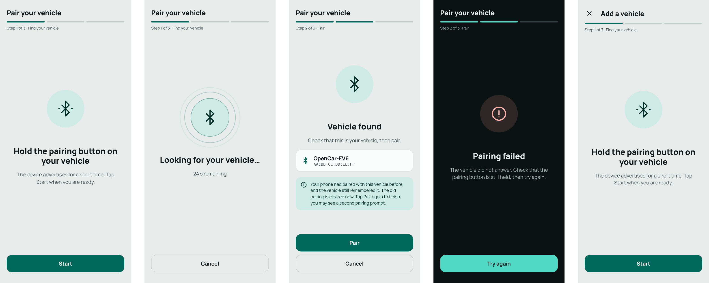
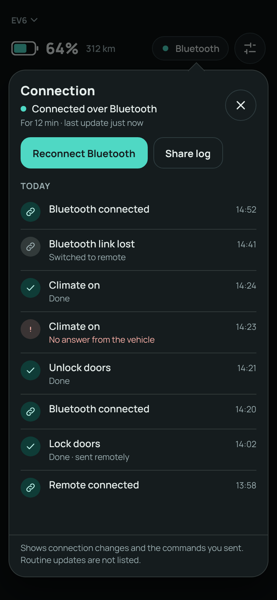
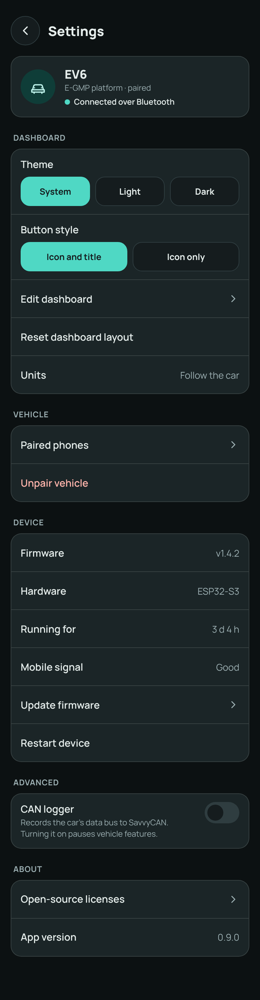
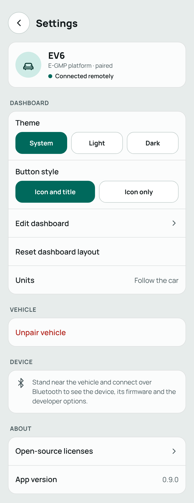
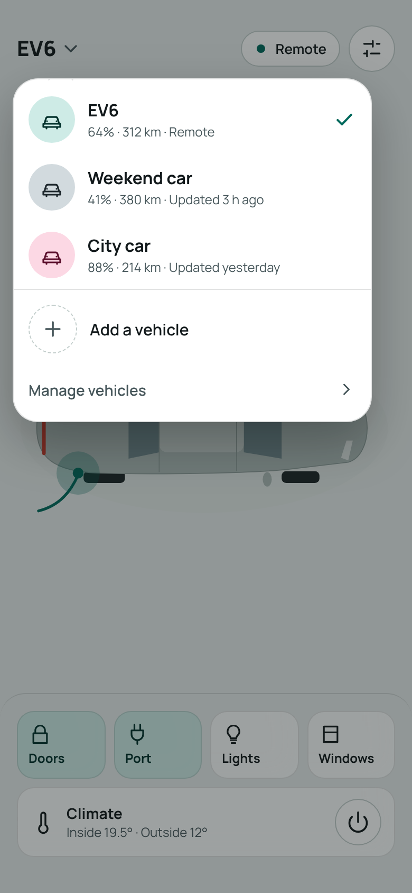
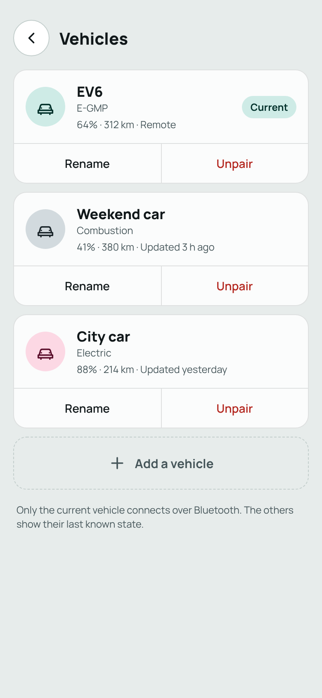
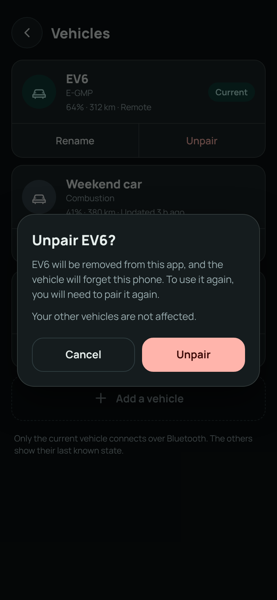

# Other screens

The screens around the [dashboard](ui.md): the setup wizard, the connection activity popover, settings, and vehicle switching and management. They share the dashboard's components, tokens and [skin](ui-theming.md). The mockups are in [`ui/mockups`](ui/mockups/README.md).

> **Status:** these are designs, not the current behaviour. The setup wizard is only restyled here; its steps will change when it is overhauled ([#27](https://github.com/OpenCarControls/mobile-app/issues/27)).

## Setup wizard
The wizard pairs a vehicle. Today it is `PairingWizardScreen`, which has five steps: prompt, scanning, found, pairing and error (see [BLE & pairing](ble.md)). The design only sets the style; it does not change the flow.

*   **Frame:** the step title at the top and a segmented progress bar with a step label ("Step 2 of 3 · Pair"). A large icon medallion in the middle, a title and one short paragraph, and full-width buttons at the bottom. The step count (three) and the names of the steps are placeholders until the wizard is overhauled.
*   **Steps in the mockup:**
    *   *Prompt:* "Hold the pairing button on your vehicle", then **Start**.
    *   *Scanning:* pulsing rings around the Bluetooth icon, the time remaining, **Cancel**.
    *   *Found:* the device name and id in a card, a note when the phone had a stale bond (the existing text, shortened), **Pair** and **Cancel**.
    *   *Error:* a danger-coloured medallion, a plain explanation, **Try again**.
    *   *Pairing* (waiting for the system dialog) looks like scanning with different text and is not mocked.
*   **Adding another vehicle:** the same wizard, with a close button and the heading "Add a vehicle". The first run has no close button, because there is nothing to go back to.
*   **Skin:** before the vehicle is known the wizard uses the default skin. Once a platform is detected (the existing `platform_id` match), its skin can take over for the rest of the flow.
*   **Debug:** the HTTP form stays behind `kDebugMode` and is not mocked.

Messages should say what to do, not what failed technically. Related issues: [#27 setup wizard](https://github.com/OpenCarControls/mobile-app/issues/27), [#42 app spins forever without the phone's bond](https://github.com/OpenCarControls/mobile-app/issues/42).

## Connection activity
Tapping the connection pill on the dashboard opens a small popover anchored to it (the dashboard is dimmed behind). It answers "what is the app doing with my car?" in plain words.

*   **Header:** the current state (for example "Connected over Bluetooth") and how long it has been connected and when the last update came, plus a close button.
*   **Actions:** **Reconnect Bluetooth** (the same action as pull-to-refresh) and **Share log**.
*   **The log:** newest first, grouped by day, each entry an icon, a short title, an optional detail line and the time.

| Logged | Example |
|---|---|
| Connection changes | "Bluetooth connected", "Bluetooth link lost · Switched to remote", "Remote connected" |
| Commands sent and what came of them | "Unlock doors · Done", "Lock doors · Done · sent remotely", "Climate on · No answer from the vehicle" |
| Not logged | State updates, heartbeats and other routine traffic |

*   Failures use the danger colour on the detail line only, with the icon; colour is not the only cue.
*   It is not a technical log: no UUIDs, message ids or error codes in the list.
*   A footer states what is and is not listed.

Open decisions:
*   **Share log:** what it contains. It should be plain text and exclude identifiers such as the device id, the broker address and credentials.
*   **Retention:** how many entries or how long are kept, and whether they survive an app restart.
*   It could also show commands whose result is unknown after a transport change, which overlaps with [Resend or report pending commands when the transport changes](https://github.com/OpenCarControls/mobile-app/issues/23).

## Settings
Opened from the settings button in the dashboard header. A back button and the title, a summary card for the current vehicle (name, platform, how it is connected), then grouped sections. Each section is a card of rows; rows are at least 56 dp high.

| Section | Rows | Tier |
|---|---|---|
| Dashboard | Theme (System / Light / Dark); button style (icon and title, or icon only); Edit dashboard; Reset dashboard layout; Units ("Follow the car", read-only) | Both |
| Vehicle | Paired phones (the count; needs BLE system commands); Unpair vehicle (danger colour) | Paired phones: Bluetooth only. Unpair: both |
| Device | Firmware version; hardware; running time; mobile signal; Update firmware ([#28](https://github.com/OpenCarControls/mobile-app/issues/28)); Restart device | Bluetooth only |
| Advanced | CAN logger switch, with what it does and, when on, the address to enter in SavvyCAN ([#40](https://github.com/OpenCarControls/mobile-app/issues/40)) | Bluetooth only |
| About | Open-source licenses; app version | Both |

*   **Remote:** the Device and Advanced sections become one note: "Stand near the vehicle and connect over Bluetooth to see the device, its firmware and the developer options." The system commands are Bluetooth-only (see [Architecture](architecture.md)).
*   **Switches and segmented controls** follow the skin (radii, accent).
*   **The CAN logger** reflects the state the device reports, not the last tap, and warns that vehicle features pause while it runs.
*   **Unpair** asks for confirmation (see [Vehicles](#vehicles)).
*   **Debug-only entries** (the HTTP simulation toggle, the debug drawer) are not mocked and stay behind `kDebugMode`.
*   The device rows could grow, for example CAN bus health ([#30](https://github.com/OpenCarControls/mobile-app/issues/30)).

## Vehicles
The app can be paired to several vehicles. One is *current*: it owns the dashboard, the live connection and the layout in use.

### Switching
*   The vehicle name in the dashboard header has a chevron. Tapping it opens a popover anchored to the name (the dashboard is dimmed behind), shown even when only one vehicle is paired, since it is the quickest way to add a second.
*   Each row: a circular avatar in that vehicle's own skin colours, so the cars are easy to tell apart, the name, and a line with the last known level, range and state ("64% · 312 km · Remote", "41% · 380 km · Updated 3 h ago"). A checkmark marks the current vehicle.
*   Below the list: **Add a vehicle** (opens the [wizard](#setup-wizard) in its "add" form) and **Manage vehicles**.
*   Tapping another vehicle switches to it: the dashboard changes to its skin and layout. Switching away from a vehicle connected over Bluetooth ends that link and starts the other vehicle's connection; the connection pill shows the change as it happens.
*   There is no swipe between vehicles; it would conflict with the scrolling grid.

### Managing
A **Vehicles** screen, reached from "Manage vehicles" in the switcher (a Vehicles row in settings is a natural second entry, not mocked): one card per vehicle with its name, platform, last known state and a **Current** badge on the current one, and **Rename** and **Unpair** under each. A dashed **Add a vehicle** tile ends the list. A note explains that only the current vehicle connects over Bluetooth and the others show their last known state.

### Unpairing
Unpair asks for confirmation in a dialog: "Unpair EV6?", that the vehicle is removed from this app, that the vehicle will forget this phone, that pairing again is needed to use it, and that other vehicles are not affected. The confirm button uses the danger colour. If it is the last vehicle, the app returns to the first-run wizard, as today, and the text drops the sentence about other vehicles. Removing the phone's bond on the device is tracked in [#25](https://github.com/OpenCarControls/mobile-app/issues/25).

### What it means for the app
This changes the app's model, which today holds one vehicle (see [Architecture](architecture.md)):

*   Pairing state becomes a list of paired vehicles plus the id of the current one. `pairedVehicleProvider` and `selectedVehicleProvider` hold a single vehicle today, and the router shows the wizard only when the list is empty.
*   Only the current vehicle has a live transport and live state. The others show their last snapshot, kept per vehicle (for example in the paired-vehicle store); their level, range and update time feed the lists above. An MQTT subscription per vehicle would give fresher values but costs connections, so it is not assumed.
*   The saved dashboard layouts (see [Tiles](ui.md#default-layouts-and-persistence)) are keyed by vehicle and tier.
*   Each vehicle has a user-editable name and keeps its platform id; the existing platform-mismatch check applies per vehicle.
*   The connection activity log is per vehicle.
