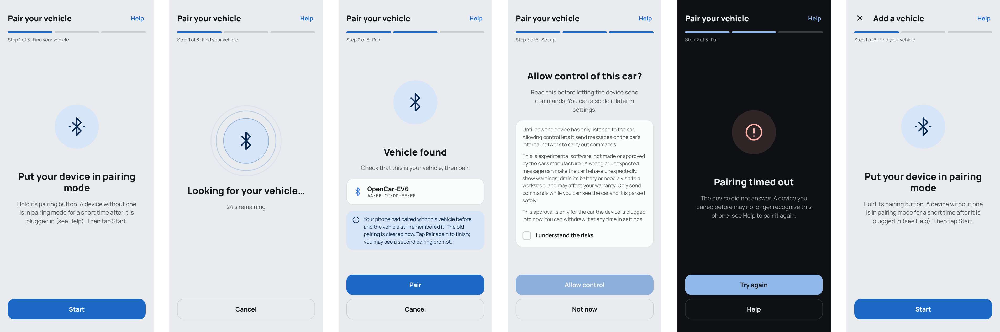
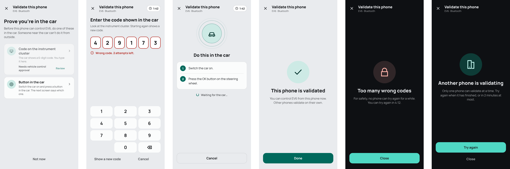
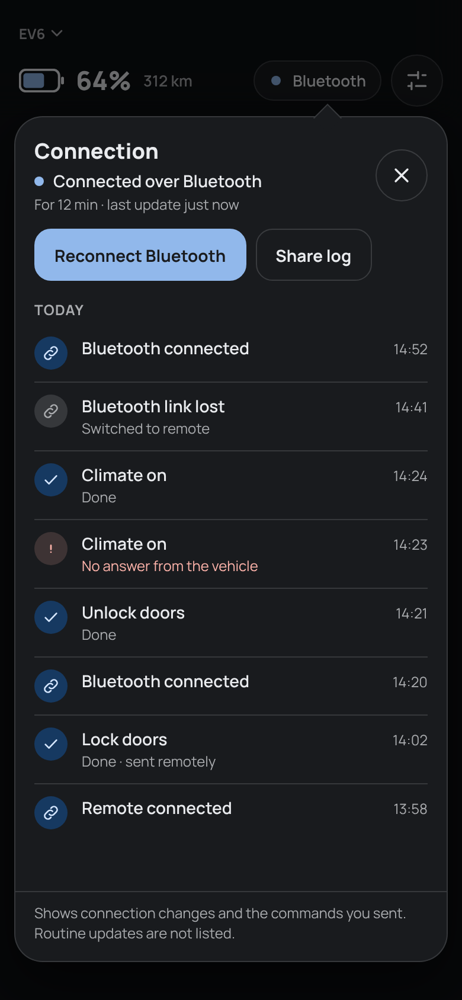
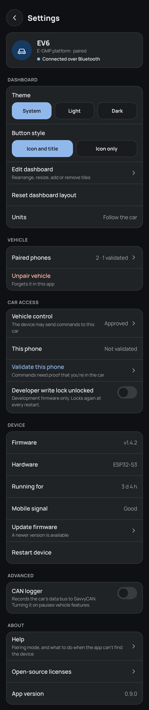
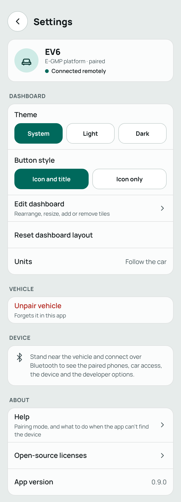
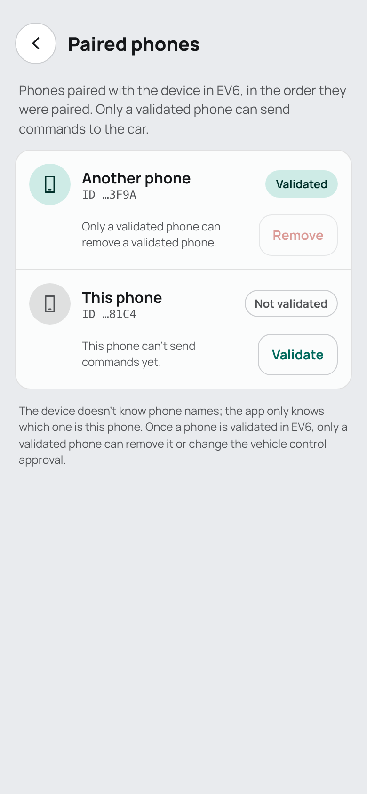
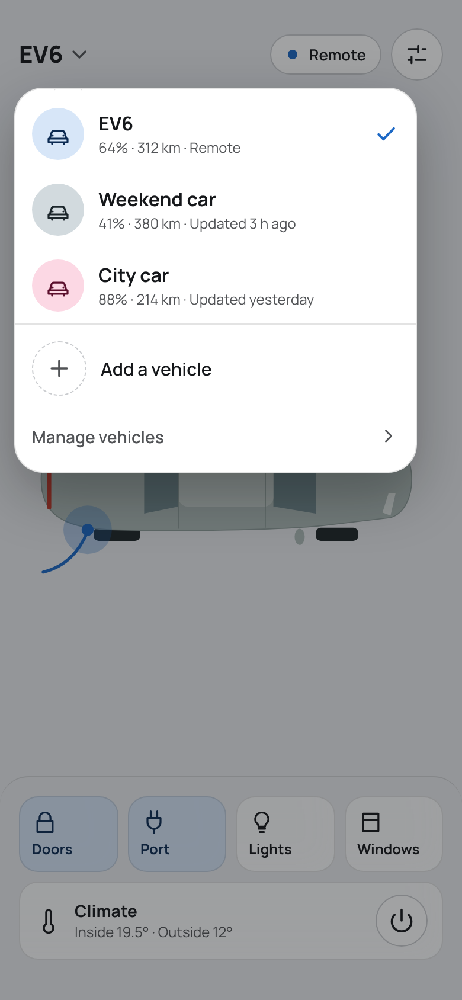
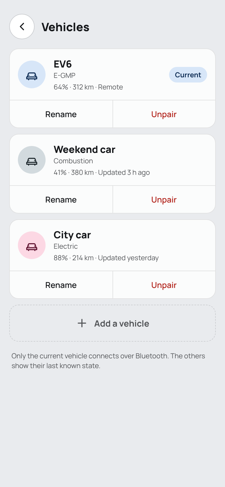
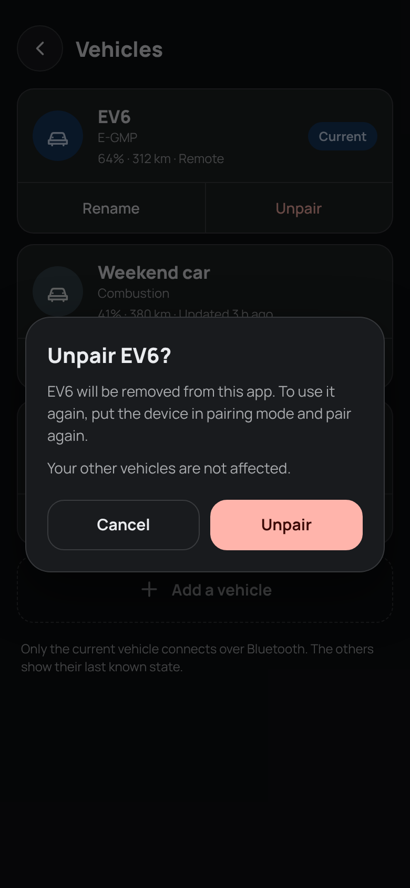

# Other screens

The screens around the [dashboard](ui.md): the setup wizard, phone validation, the connection activity popover, settings and the paired phones, and vehicle switching and management. They share the dashboard's components, tokens and [skin](ui-theming.md). The mockups are in [`ui/mockups`](ui/mockups/README.md).

> **Status:** the setup wizard, phone validation and settings are built; the rest are designs, not the current behaviour. The wizard's overhaul ([#27](https://github.com/OpenCarControls/mobile-app/issues/27)) will add more set-up steps than the approval shown here.

## Setup wizard
The wizard (`PairingWizardScreen`) pairs a vehicle and then sets it up (see [BLE & pairing](ble.md)). After pairing it waits for the device to report its CAN access, up to 20 s, and shows the approval only if this car needs it and this phone may give it. If the car isn't identified in that time, or the app is closed, the dashboard's banners offer the same steps.

*   **Frame:** the step title, **Help** at the top right (as today's app bar), and a segmented progress bar with a step label ("Step 2 of 3 · Pair"). A large icon medallion in the middle, a title and one short paragraph, and full-width buttons at the bottom. The step names and count (Find, Pair, Set up) may change when the wizard is overhauled ([#27](https://github.com/OpenCarControls/mobile-app/issues/27)).
*   **Steps in the mockup:**
    *   *Prompt:* "Put your device in pairing mode", with the button and the power-cycling case explained the way [Help](ble.md) does it, then **Start**.
    *   *Scanning:* pulsing rings around the Bluetooth icon, the time remaining, **Cancel**.
    *   *Found:* the device name and id in a card, a note when the phone had a stale bond (the existing text, shortened), **Pair** and **Cancel**.
    *   *Set up: allow control.* The CAN read-write approval, with the existing risks text in a card and **Allow control** enabled only once "I understand the risks" is ticked. **Not now** skips it.
    *   *Timed out:* a danger-coloured medallion, the plain explanation from today's wizard (a device paired before may no longer recognise this phone), **Try again** and **Help**.
    *   *Pairing* (waiting for the system dialog) looks like scanning with different text and is not mocked.
*   **After the wizard:** the approval comes first, because a validation method that shows a code on the car's display needs it. [Phone validation](#phone-validation) isn't a wizard step: the dashboard offers it next, with its banner. Both can be done later from [settings](#settings) and from the dashboard's banners, so skipping never strands the user.
*   **Adding another vehicle:** the same wizard, with a close button and the heading "Add a vehicle". The first run has no close button, because there is nothing to go back to.
*   **Skin:** before the vehicle is known the wizard uses the default skin. Once a platform is detected (the existing `platform_id` match), its skin can take over for the rest of the flow.
*   **Kept from today:** the connect retry, the pairing-window timeout, the stale-bond handling and the HTTP form behind `kDebugMode` (not mocked).

Messages say what to do, not what failed technically.

## Phone validation
Vehicle commands need a *validated* phone: one whose owner proved, in the car, that it is theirs, by something a stranger near the car can't do ([#60](https://github.com/OpenCarControls/mobile-app/issues/60)). A paired phone that isn't validated can use everything else (state, system commands, and the approval before any phone is validated), on the [remote layout](ui.md#the-two-tiers) with its command tiles greyed out. Validation is BLE only and belongs to the car: moving the device to another car, removing the phone's bond or resetting the bonds means validating again.

The flow is a full-screen modal with a close button, the vehicle name and, while a session runs, the time left.

1.  **Choose a method.** A short explanation ("Prove you're in the car") and the car's methods as cards, in the order the device lists them. Each card has an icon, a title and one sentence. A method the device reports as unavailable is greyed out, with no reason from the device; the card's sentence says what the method needs. The list is read again every few seconds, so a method lights up when the car allows it. When the method needs the CAN read-write approval (a code on the cluster does) and this phone can give it, the card says so, with **Review**, which opens the approval. **Not now** closes the flow.
2.  **Code entry** (a code shown in the car). A row of `code_length` digit boxes, a numeric keypad, and the session's time left. It submits by itself once every digit is in. A wrong code turns the boxes and the message red: "Wrong code. 2 attempts left." **Show a new code** starts the session again, and the car shows a new code; **Cancel** ends it.
3.  **In-car action.** Numbered instructions for the method, "Waiting for the car…", the time left and **Cancel**. The app waits for the session to end, and moves on by itself.
4.  **How it ended:**

| Ending | Screen |
|---|---|
| Validated | "This phone is validated", **Done** |
| Too many wrong codes, or a start refused during the cooldown | "Too many wrong codes", the cooldown left, during which no phone can start again; **Close** |
| Timed out | "Time's up", **Start again** and **Close** (not mocked) |
| Another phone is validating | "Another phone is validating", **Try again** and **Close** |
| Cancelled, or the car changed | Back to the method list (not mocked) |

*   **Text:** every method's title, description and instructions come from the app, keyed by `method_id` (for example `virtual_car.cluster_code`, `virtual_car.button`), with a generic text per method kind for an id the app doesn't know. No text comes from the device. The instructions in the mockup ("Press the OK button on the steering wheel") are an example.
*   **Numbers:** the session length, code length, attempts and cooldown come from the contract (`[ble.phone_validation]` in `transport.toml`) for the instructions; the time, attempts and cooldown left come from the session itself.
*   **Refusals:** the device says why it refused a command in `PhoneValidationRefusal`, and the app words it. Closing the flow during a session cancels it.
*   **Entry points:** the "Validate this phone" banner on the dashboard, a tap on a tile greyed out because the phone isn't validated, the **Validate** action on a command the device refused for that reason, the Car access section in settings, and the Paired phones screen.

## Connection activity
Tapping the connection pill on the dashboard opens a small popover anchored to it (the dashboard is dimmed behind). It answers "what is the app doing with my car?" in plain words.

*   **Header:** the current state (for example "Connected over Bluetooth") and how long it has been connected and when the last update came, plus a close button.
*   **Actions:** **Reconnect Bluetooth** (the same action as pull-to-refresh) and **Share log**.
*   **The log:** newest first, grouped by day, each entry an icon, a short title, an optional detail line and the time.

| Logged | Example |
|---|---|
| Connection changes | "Bluetooth connected", "Bluetooth link lost · Switched to remote", "Remote connected" |
| Commands sent and what came of them | "Unlock doors · Done", "Lock doors · Done · sent remotely", "Climate on · No answer from the vehicle" |
| Not logged | State updates, heartbeats and other routine traffic |

*   Failures use the danger colour on the detail line only, with the icon; colour is not the only cue.
*   It is not a technical log: no UUIDs, message ids or error codes in the list.
*   A footer states what is and is not listed.

*   **Remote connected** means the vehicle answered over MQTT, the moment the pill changes to "Remote", not that the broker was reached. It is logged again when the vehicle comes back after going quiet.
*   **Commands** are logged by what the tap asked for ("Unlock doors"), when the result is known. Tapping a greyed-out control is logged as refused, since nothing was sent.
*   **Local to this phone:** the log records only what this phone saw and did. It is not synced with the vehicle or other phones, so a command from another phone or something done in the car doesn't appear.
*   **Retention:** the last 200 entries per vehicle. They survive an app restart and are deleted when the vehicle is unpaired.
*   **Share log:** plain text with the listed lines and their dates and times, the app version and the vehicle's platform name. It leaves out the custom vehicle name, device id, broker address, credentials and raw error text.
*   Commands whose result is unknown after a transport change can be added as another result once [Resend or report pending commands when the transport changes](https://github.com/OpenCarControls/mobile-app/issues/23) is done.

## Settings
Opened from the settings button in the dashboard header. A back button and the title, a summary card for the current vehicle (name, platform, how it is connected), then grouped sections. Each section is a card of rows; rows are at least 56 dp high.

| Section | Rows | Tier |
|---|---|---|
| Dashboard | Theme (System / Light / Dark); button style (icon and title, or icon only); Edit dashboard (closes settings and starts the [editor](ui.md#editing); off with the reason while the remote grid is locked); Reset dashboard layout (every grid of this vehicle back to its default, unlike the editor's Reset, which is for the grid being edited); Units ("Follow the car", read-only) | Both |
| Vehicle | Paired phones (the count and how many are validated; opens [Paired phones](#paired-phones)); Unpair vehicle (danger colour; forgets the vehicle in this app) | Paired phones: Bluetooth only. Unpair: both |
| Car access | Vehicle control: the CAN read-write approval and its state, opening the approval or the withdraw confirmation (today's `CanAccessSection`); This phone: validated or not, with **Validate this phone** when it isn't; the developer write lock switch, in development firmware only | Bluetooth only |
| Device | Firmware version; hardware; running time; mobile signal; Update firmware ([#28](https://github.com/OpenCarControls/mobile-app/issues/28)); Restart device | Bluetooth only |
| Advanced | CAN logger switch, with what it does and, when on, the address to enter in SavvyCAN ([#40](https://github.com/OpenCarControls/mobile-app/issues/40)) | Bluetooth only |
| About | Help (pairing mode and recovery, as today's Help screen); open-source licenses; app version | Both |

*   **Remote:** the Bluetooth-only sections become one note: "Stand near the vehicle and connect over Bluetooth to see the paired phones, car access, the device and the developer options." The system commands are Bluetooth-only (see [Architecture](architecture.md)).
*   **Car access** rows follow the device: once a phone is validated in this car, only a validated phone can change the approval, so on another phone the approval controls are disabled with that reason.
*   **Switches and segmented controls** follow the skin (radii, accent).
*   **The CAN logger** reflects the state the device reports, not the last tap, and warns that vehicle features pause while it runs.
*   **Unpair** asks for confirmation (see [Vehicles](#vehicles)).
*   **Debug-only entries** (the HTTP simulation toggle, the debug drawer) are not mocked and stay behind `kDebugMode`.
*   The device rows could grow, for example CAN bus health ([#30](https://github.com/OpenCarControls/mobile-app/issues/30)).

### Paired phones
The phones paired with the device, in the order they were paired (BLE only). The device doesn't know phone names, so each phone shows as "This phone" or "Another phone" with the end of its id. Each has a trust chip: **Validated** or **Not validated**.

*   This phone, when it isn't validated, has **Validate**.
*   Other phones have **Remove**, with a confirmation. Once a phone is validated in this car, only a validated phone can remove a validated phone, so on a phone that isn't validated the button is disabled with that reason. The device only removes phones during its pairing window and doesn't answer an accepted request, so the app reads the list again and says so if the phone is still there.
*   Removing this phone's own bond and clearing all phones are part of unpairing and [#25](https://github.com/OpenCarControls/mobile-app/issues/25).

## Vehicles
The app can be paired to several vehicles. One is *current*: it owns the dashboard, the live connection and the layout in use.

### Switching
*   The vehicle name in the dashboard header has a chevron. Tapping it opens a popover anchored to the name (the dashboard is dimmed behind), shown even when only one vehicle is paired, since it is the quickest way to add a second.
*   Each row: a circular avatar in that vehicle's own skin colours, so the cars are easy to tell apart, the name, and a line with the last known level, range and state ("64% · 312 km · Remote", "41% · 380 km · Updated 3 h ago"). A checkmark marks the current vehicle.
*   Below the list: **Add a vehicle** (opens the [wizard](#setup-wizard) in its "add" form) and **Manage vehicles**.
*   Tapping another vehicle switches to it: the dashboard changes to its skin and layout. Switching away from a vehicle connected over Bluetooth ends that link and starts the other vehicle's connection; the connection pill shows the change as it happens.
*   There is no swipe between vehicles; it would conflict with the scrolling grid.

### Managing
A **Vehicles** screen, reached from "Manage vehicles" in the switcher (a Vehicles row in settings is a natural second entry, not mocked): one card per vehicle with its name, platform, last known state and a **Current** badge on the current one, and **Rename** and **Unpair** under each. A dashed **Add a vehicle** tile ends the list. A note explains that only the current vehicle connects over Bluetooth and the others show their last known state.

### Unpairing
Unpair asks for confirmation in a dialog: "Unpair EV6?", that the vehicle is removed from this app, that using it again means putting the device in pairing mode and pairing again, and that other vehicles are not affected. Unpairing only forgets the vehicle in the app; the device keeps the phone's bond until [#25](https://github.com/OpenCarControls/mobile-app/issues/25) changes that. The confirm button uses the danger colour. If it is the last vehicle, the app returns to the first-run wizard, as today, and the text drops the sentence about other vehicles.

### What it means for the app
This changes the app's model, which today holds one vehicle (see [Architecture](architecture.md)):

*   Pairing state becomes a list of paired vehicles plus the id of the current one. `pairedVehicleProvider` and `selectedVehicleProvider` hold a single vehicle today, and the router shows the wizard only when the list is empty.
*   Only the current vehicle has a live transport and live state. The others show their last snapshot, kept per vehicle (for example in the paired-vehicle store); their level, range and update time feed the lists above. An MQTT subscription per vehicle would give fresher values but costs connections, so it is not assumed.
*   The saved dashboard layouts (see [Tiles](ui.md#default-layouts-and-persistence)) are keyed by vehicle and tier.
*   Each vehicle has a user-editable name and keeps its platform id; the existing platform-mismatch check applies per vehicle.
*   The connection activity log is per vehicle.
