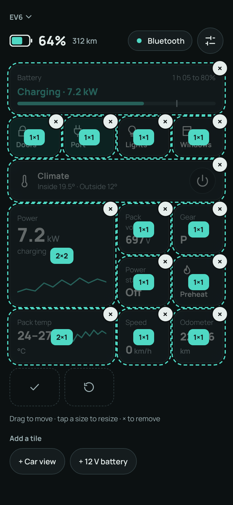
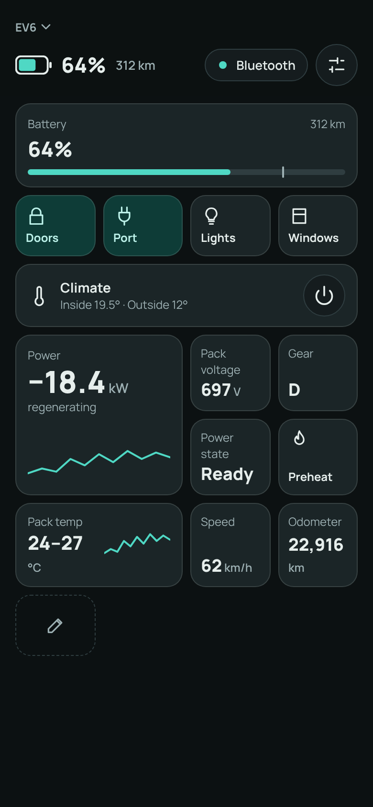

# UI design

The target design for the dashboard: one shared look and structure for every vehicle platform, built from tiles, with a remote (basic) tier and a Bluetooth (basic + advanced) tier. Platforms choose the tiles, their default layout and a skin. They never provide their own screen.

> **Status:** this is a design, not the current behaviour. The app still has one screen per vehicle (see [Architecture](architecture.md#per-vehicle-screens-libcarsvehiclescreens)). Remove this note once the dashboard is rebuilt.

Related: [Other screens](ui-screens.md) (setup wizard, connection activity, settings, vehicles) · [Theming & skins](ui-theming.md) · [3D hero](ui-hero.md) · [Mockups](ui/mockups/README.md) · [Architecture](architecture.md)

## Principles
*   **One UI, many cars.** Layout, components, states and motion are shared. A platform provides its tiles, their default layout, its level type, its hero and its [skin](ui-theming.md).
*   **Remote first, Bluetooth supercharged.** Over MQTT the screen is calm and Tesla-app-like: the car and a few basic tiles. Over BLE the car steps back and the screen becomes a dense, customisable tile dashboard, in the spirit of the S3XY Buttons app. Same components, more on screen.
*   **Tiles are the unit.** A tile can show state, send a command, or both. There are no state-only and control-only kinds; a lock tile can show the lock state, a stat tile can include a button. A tile's *content* can depend on state (the Battery tile reads differently when idle, charging or exporting power), but the *set* of tiles never changes with state: nothing appears or disappears by itself.
*   **The state drives the picture.** The hero is never rotated by the user. Vehicle state picks the camera and animations (see [3D hero](ui-hero.md)).
*   **No guessing.** Show only what the active transport can deliver and what the vehicle reports. Never show a stale value as live.
*   **Energy-agnostic.** The header has a level and a range. The level is a battery or a fuel tank, so ICE and hybrid vehicles fit without a different layout.

## Decisions
| Decision | Why |
|---|---|
| A single shared dashboard instead of one screen per platform | Per-platform screens drifted into a patchwork and each needed its own polish. Platforms keep control through tiles, order and [skin](ui-theming.md). |
| The Bluetooth tier has no hero by default; the car can come back as a "Car view" tile | In the car you don't need the picture, and it takes space the dashboard can use. As a tile, the same 3D widget serves users who want it. |
| One tile system for both tiers, with a different default layout and tile set for each | One component, one editor, one persistence model. Remote shows basic tiles over the hero; Bluetooth adds advanced tiles. |
| Real-time 3D hero, camera locked and state-driven (remote tier) | The camera moves between views and parts animate (doors, lights, charge port). Pre-rendered layers would need a full image set per camera position. See [3D hero](ui-hero.md). |
| On the remote tier, tiles scroll over the hero on a frosted layer | The car fills the free space and the tiles can cover it when there are many. |
| Level indicator is a battery or tank glyph beside the percentage | It matches the number's size and works for fuel. Range stays, smaller, because some users want it. The Battery tile repeats it with the charging detail (the repetition is kept for now). |
| Four tiles per row; state shown by fill and icon rather than a status line | Icon + title + status text in a small box was too much. |
| Climate is one bar; target temperature and extras appear only when climate is on | They need climate on. Inside and outside temperature are always visible. |
| No contextual tiles | Tiles that appear and disappear by state make the layout unpredictable. Contextual *content* inside a stable tile gives the same information. |
| Light and dark themes, Material 3 foundations with a custom skin layer | Familiar widgets, but shapes and colours are ours to vary per platform. |

## The two tiers
| | Remote (MQTT) | Bluetooth (BLE; also stub/HTTP in debug) |
|---|---|---|
| Hero | Yes, behind the tiles | No (optional Car view tile) |
| Header | Vehicle name, level row, status line, speed while driving | Small vehicle name, one slim level row |
| Tiles | Basic tiles only | Basic and advanced tiles |
| Default layout | Four buttons and climate | Battery, buttons, climate, stats and charts |
| Editing | Same editor, basic tiles only (not mocked) | Edit tile at the end of the grid |
| System commands (settings: device, advanced) | No | Yes |

Gate on the transport type, never on the vehicle (see the transport gating in [Architecture](architecture.md)). Over MQTT, advanced tiles are left out, not shown disabled.

## Screen anatomy

### Remote tier
Three layers, back to front.

1.  **Hero** (back). The 3D car (or its placeholder) in a box between the header and the tiles, centred in it.
2.  **Tile grid** (middle). A scrolling, frosted layer over the hero. When short, it rests at the bottom of the screen. When tall, it scrolls over the hero.
3.  **Header** (front). Pinned and translucent, so scrolled tiles blur out underneath.

**Hero box**
*   The box spans the full width (16 dp side padding) and the height between the header and the top of the tiles. The car is centred in it and scaled to fit its width, so it never clips.
*   When the tiles grow (climate unfolds, tiles are added) the box shrinks and the car moves up with it, animated, staying centred.
*   The box has a minimum height. Below it, the box stops shrinking and the tiles scroll over the hero.
*   The hero is a separate widget behind a small interface; the dashboard only gives it a box. See [3D hero](ui-hero.md).

### Bluetooth tier
Two layers: a pinned translucent header over a full-screen scrolling tile grid. There is no hero layer, and the grid starts right under the header.

### Wide layouts
*   **Remote:** the hero fills the left column with the header over it; the tiles move to a fixed-width solid side column that scrolls on its own.
*   **Bluetooth:** the grid uses the full width with eight columns, so tile spans keep their meaning and more tiles fit per row.

## Header

### Remote header
*   **Vehicle name** with a chevron: tap to switch vehicle (see [Vehicles](ui-screens.md#vehicles)).
*   **Connection pill** and a **settings** button.
*   **Level row:** a battery or tank glyph (filled to the level), the level in %, the range in a smaller muted style. While driving, the **speed** sits at the right of this row.
*   **Status line**, only when it has something to say.

| Status condition | Text |
|---|---|
| Driving | `Driving` (the speed appears in the level row) |
| Charging | `Charging · 7.2 kW · 1 h 05 to 80%` (time to the limit, plus time to 80% on DC) |
| Otherwise | nothing (there is no "Parked" state) |

### Bluetooth header
*   The vehicle name in small muted text, with its chevron, above one row.
*   The row: the level glyph, the level in %, the range, then the connection pill and the settings button. There is no status line or speed here; the Battery and Speed tiles carry them.

### Connection pill
| State | Pill |
|---|---|
| Connected over MQTT | `● Remote` (accent dot) |
| Connected over BLE | `● Bluetooth` (accent dot) |
| Not connected / state is stale | `● Offline · Updated 12 min ago` (neutral dot) |

*   While connected there is no update text; it only appears when not connected.
*   While a command is being sent, the dot becomes a small spinning ring until the response arrives. This is the app-wide "sending" indication; individual tiles pulse as well.
*   Tapping the pill opens the connection activity popover (see [Connection activity](ui-screens.md#connection-activity)).

### Level indicator
EV: a battery glyph. ICE: a fuel-pump/tank glyph with the fill. Hybrids show both, one row each. The level number is the primary text and the range is secondary. Distances and speeds follow the unit the car displays (km or miles). A tap on the level to swap percent and range is a possible later addition.

## Tiles

### The grid
*   Four columns on phones (eight on the wide Bluetooth layout), 8 dp gaps, a row at least 64 dp high (56 dp for icon-only buttons). A tile spans whole columns and rows.
*   Tiles are laid out in order, flowing left to right and filling gaps (a dense flow), so a mixed set of sizes packs without holes.
*   The grid scrolls vertically under the pinned header. On the Bluetooth tier it is the whole screen.

### Kinds and sizes
Each kind declares the sizes it supports; bigger sizes show more.

| Kind | Sizes (columns × rows) | What it shows |
|---|---|---|
| Command | 1×1, 2×1 | An icon and, by default, a one-word title. Its state is shown by fill and icon change (lock open or closed). At 2×1 it also shows a caption with the state. |
| State | 1×1, 2×1, 2×2 | A value with a label. 2×1 adds a sparkline; 2×2 adds a large value, a note and a chart. |
| Battery or Fuel | 4×1 | Level, range and charging state in one tile (see below). |
| Climate | 4×1 (unfolds in place) | The climate bar and, when on, the target and extras. |
| Car view | 2×2, 4×2 | The 3D hero as a tile. |

Kinds are layouts. What a tile shows is up to the platform, so a command tile can carry a live value, a state tile can have a button and so on. The mockups contain only examples; the real tiles are designed per platform.

### Content can depend on state
A tile may show different content by state while keeping its place and size. The Battery tile is the example:

| State | Battery tile |
|---|---|
| Not charging | The level in %, the range, and the level bar with a tick at the charge limit |
| Charging | `Charging · 7.2 kW`, the time to the limit (`1 h 05 to 80%`), and the same bar and tick |
| Exporting power (V2L) | Not mocked; it should show the outgoing power in the same place |

### Command tile states
| State | Look |
|---|---|
| Idle | Frosted surface |
| On / active | Accent-container fill |
| Pending | Border in the accent colour and a pulsing fade until the `CommandResponse` arrives (or the 15 s timeout). The connection pill spins too. |
| Unavailable (over this transport, or the car can't do it now) | Dimmed, with an explanation on tap; see [States](#states-and-edge-cases) |
| Error | Brief error feedback (a snackbar with the `CarTransportException` message); not yet mocked |

*Titled* (default) and *icon-only* buttons are both supported, per platform with a user override in settings. Icon-only buttons still need an accessible label that includes the state (for example "Doors, locked").

### Climate tile
One bar the height of a button row. It always shows the title, "Inside 19.5° · Outside 12°" and a power button. While a command is pending only the power button pulses; the temperatures stay.

When climate is on, a panel unfolds under the bar:
*   A full-width target-temperature stepper (− value +).
*   A row of small icon buttons for the platform's climate extras (windshield defrost, rear defrost, steering-wheel heater, seat heating). Seat heating shows its level (off/low/medium/high) as three dots and carries an L or R tag.

The extras are part of the same climate command, so they are only offered while climate is on. Which extras exist, and which side is the driver's, come from the vehicle description. Confirm per car whether the car accepts them with climate off. The tile is the only one that cannot be resized.

### Default layouts and persistence
*   Every platform ships a default layout for each tier, so nobody starts with an empty screen. Defaults reference tiles by stable id.
*   The user's layout is saved per vehicle and per tier. Switching vehicle switches layout.
*   A new app version that adds tiles does not insert them into a saved layout. They show up in the "Add a tile" list.
*   "Reset" restores the platform's default.

### Editing
The edit control is a small tile with a dotted border and a pencil, placed after the last tile, so it takes no space elsewhere. Tap it to enter edit mode:

*   Every tile gets a dashed outline and is dimmed under an overlay holding an **×** (remove) at its corner and, if the tile has more than one size, a **size badge** (for example `1×1`) in the middle. Tapping the badge cycles through the sizes the kind supports.
*   Tiles can be dragged to move. Commands do not run while editing.
*   The pencil tile becomes two: **Done** (check) and **Reset** (undo arrow).
*   Under the grid: a hint line and an **Add a tile** list of tiles not on the dashboard (for example the Car view tile or a stat that was removed).

Because dragging alone is not accessible, edit mode must also offer move actions (for example "move earlier/later" in the tile's actions), and every control needs a label. The drag gesture itself is not mocked.

## States and edge cases
*   **Not connected / stale.** The pill says Offline and when the state was last updated. Values from the last snapshot stay on screen but must not look live (dim them, or mark them). This overlaps with [Show stale or asleep vehicle state](https://github.com/OpenCarControls/mobile-app/issues/29).
*   **Command pending.** The tile that sent the command pulses and the pill's dot spins. Other tiles stay usable unless the platform forbids concurrent commands.
*   **Unavailable commands.** A tile for a command the current link or car state can't run is dimmed and says why on tap (for example "Needs Bluetooth"). This overlaps with [Gray out unavailable commands](https://github.com/OpenCarControls/mobile-app/issues/22).
*   **Platform mismatch.** The existing mismatch banner appears above the header content and keeps its unpair action.
*   **Charging.** The charge-port tile is on, the Battery tile shows the charging state, and on the remote tier the hero shows the cable and the port glow and the status line shows the charging text.
*   **Driving.** On the remote tier the hero shows the car on an advancing road, the speed is shown at the top right and the status line says Driving; charging text is hidden. On the Bluetooth tier a Speed tile shows the speed.
*   **Units.** Distance, speed and temperature follow the car's units (km/miles, °C/°F). The climate target steps in the car's own steps (for example 1 °F). Keep the existing formatting helpers' behaviour.
*   **Pull to refresh.** The existing pull-to-refresh that retries the BLE connection must keep working; "Reconnect Bluetooth" in the connection popover offers the same action. The gesture target on the dashboard is not yet designed (the tile grid scrolled to the top is the natural one).
*   **Settings.** The settings button opens the settings screen, replacing the old overflow menu (see [Settings](ui-screens.md#settings)). Debug-only entries and the debug drawer stay behind `kDebugMode`.

## Vehicle description
Each platform declares what the shared screen shows. This is a proposal for the shape, not a final API:

*   **Identity:** display name, platform label, [skin](ui-theming.md), hero builder ([3D hero](ui-hero.md)).
*   **Energy:** one or two levels, each battery or fuel, with accessors for the level and the range.
*   **Tile catalog:** every tile the platform offers, each with a stable id, a kind, the sizes it supports, its tier (basic or advanced), a label, an icon and accessible label, its content builder (value, caption, chart data) and its command, if any. A tile may show state, send a command, or both.
*   **Default layouts:** an ordered list of `(tile id, size)` for each tier.
*   **Climate:** whether present, target range and step (in °C and the car's own steps), the inside and outside temperature accessors, and the list of extras (id, icon, kind: toggle or leveled, side tag).
*   **Header:** the level and range for the header row, and the status line for the remote tier.

Rules from the repo that still apply: merge incoming state with `mergeFromMessage`, take `source_device_id` from `bleSourceDeviceIdProvider`, import UUIDs and IDs from generated constants, and keep debug-only paths behind `kDebugMode`.

The tiles themselves are designed one by one for each platform; the mockups only show the system they live in.

## Not yet placed
The current dashboards show things the mockups do not place yet. They must be placed (they are all natural tiles) or consciously dropped when the dashboard is rebuilt: odometer (a tile in the mockups), per-door and per-window state, frunk and trunk state, preconditioning detail, and the advanced E-GMP values ([#35](https://github.com/OpenCarControls/mobile-app/issues/35)), tire pressures and the 12 V battery ([#34](https://github.com/OpenCarControls/mobile-app/issues/34)) and the preconditioning toggle ([#36](https://github.com/OpenCarControls/mobile-app/issues/36)). The BLE button configuration in [#26](https://github.com/OpenCarControls/mobile-app/issues/26) overlaps with the tile editor and should be looked at together.

## Accessibility
*   Touch targets are at least 44 dp. The vehicle name and the edit tile need padding to reach this; the mockups draw them small.
*   Text contrast 4.5:1, large text and component boundaries 3:1. Skins must pass (see [Theming](ui-theming.md#contrast)).
*   Every icon-only control has a label; stateful tiles announce their state.
*   Colour is never the only state indicator. Fill is paired with an icon change or text.
*   Honour the system's reduce-motion setting: no pulsing, spinning, scrolling road or camera glide.
*   Editing needs a non-drag way to move tiles.
*   The tile grid must stay reachable with large system font sizes (it scrolls; on the remote tier the hero box shrinks to its minimum).

## Mockups and screenshots
The mockups are in [`ui/mockups`](ui/mockups/README.md); the screenshots were rendered from them. They are a design reference, not pixel specs: icons and glyphs are demo drawings, all values are made up and the real UI uses standard icons.

| | |
|---|---|
|  Remote, dark |  Bluetooth, driving (Speed tile, Battery tile without charging) |
|  ICE, remote, icon-only buttons |  ICE, Bluetooth (fuel tile and level) |

Design explorations that led to these choices:

Level indicator options. A (battery glyph beside the number) was chosen.

Control button options. Both were kept: A (icon-only) and B (icon + title) are a per-platform choice, B by default.

## Open questions
*   Where does pull-to-refresh live on the dashboard?
*   Tap on the level to swap percent and range?
*   Do the climate extras work with climate off on each car? (Assumed no.)
*   The error and unavailable tile states, the drag gesture and per-tile configuration are not designed.
*   Should the screen animate when the link switches between Remote and Bluetooth, which reshapes it, or wait for the user?
*   Does the remote tier get the same editor?
*   The level and range appear in both the header and the Battery tile. Keep, or drop one?
*   Is the remote hero box minimum height right on small phones and with large fonts?
