# UI design

The target design for the dashboard: one shared look and layout for every vehicle platform, with a remote (basic) tier and a Bluetooth (basic + advanced) tier. Platforms customise content and skin, not structure.

> **Status:** this is a design, not the current behaviour. The app still has one screen per vehicle (see [Architecture](architecture.md#per-vehicle-screens-libcarsvehiclescreens)). Remove this note once the dashboard is rebuilt.

Related: [Theming & skins](ui-theming.md) · [3D hero](ui-hero.md) · [Mockups](ui/mockups/README.md) · [Architecture](architecture.md)

## Principles
*   **One UI, many cars.** Layout, components, states and motion are shared. A platform provides its buttons, stats, level type, hero and [skin](ui-theming.md); it never provides its own screen.
*   **Remote first, Bluetooth supercharged.** Over MQTT the screen is calm and Tesla-app-like: the car, the essentials, a few buttons. Over BLE it gains the dense, customisable S3XY-Buttons-like content. Same screen, more on it.
*   **The state drives the picture.** The hero is never user-rotated. Vehicle state picks the camera and animations (see [3D hero](ui-hero.md)).
*   **No guessing.** Show only what the active transport can deliver and what the vehicle reports. Never show a stale value as live (see [States](#states-and-edge-cases)).
*   **Energy-agnostic.** The header has a level and a range. The level is a battery or a fuel tank, so ICE and hybrid vehicles fit without a different layout.

## Decisions
| Decision | Why |
|---|---|
| A single shared dashboard instead of one screen per platform | Per-platform screens drifted into a patchwork and each needed its own polish. Platforms keep control through content, order and [skin](ui-theming.md). |
| Real-time 3D hero, camera locked and state-driven | The camera orbits and parts animate (doors, lights, charge port). Pre-rendered layers would need a full image set per camera position. See [3D hero](ui-hero.md). |
| Controls scroll over the hero on a frosted layer | In portrait the hero area used to be a huge padding for the buttons. Now the car fills the free space and the controls can cover it. |
| Level indicator is a battery or tank glyph beside the percentage | A wide bar next to a large percentage looked out of place. The glyph matches the number's size. Range stays, smaller, because some users want it. |
| Four buttons per row, state shown by fill and icon, not by a status line | Icon + title + status text in a small box was too much. |
| Climate is one bar; the target and extras appear only when climate is on | They need climate on. The inside and outside temperature is always visible. |
| Light and dark themes, Material 3 foundations with a custom skin layer | Familiar widgets, but shapes and colours are ours to vary per platform. |

## Screen anatomy
Three layers, back to front. Portrait phone shown; the wide layout is [below](#wide-layout).

1.  **Hero** (back). The 3D car (or its placeholder). It sits in a box between the header and the controls and is centred in it.
2.  **Controls** (middle). A scrolling, frosted layer: button grid, climate bar and, over BLE, live data and advanced controls. When short, it rests at the bottom of the screen. When tall, it scrolls over the hero.
3.  **Header** (front). Pinned and translucent, so scrolled controls blur out underneath.

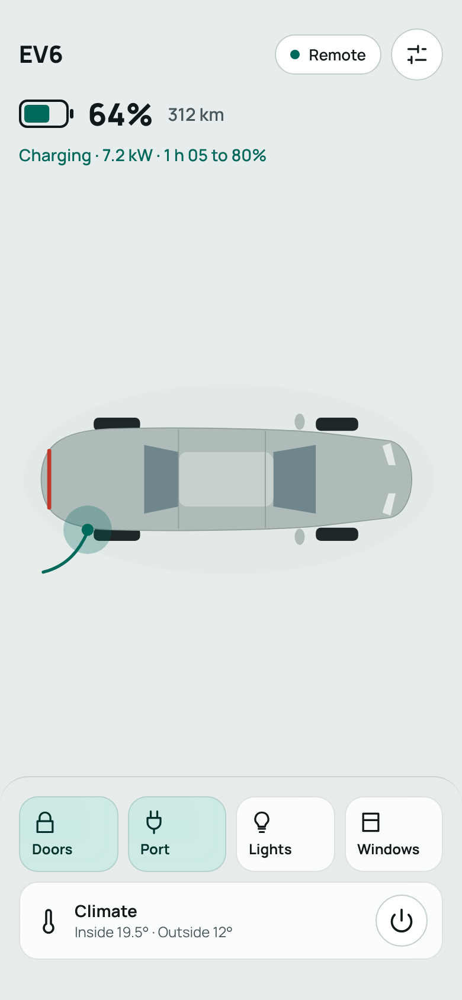

### Hero box
*   The box spans the full width (16 dp side padding) and the height between the header and the top of the controls. The car is centred in it and scaled to fit its width, so it never clips.
*   When the controls grow (climate unfolds, BLE sections appear) the box shrinks and the car moves up with it, animated, staying centred.
*   The box has a minimum height. Below it, the box stops shrinking and the controls scroll over the hero.
*   The hero is a separate widget behind a small interface; the dashboard only gives it a box. See [3D hero](ui-hero.md).

### Header
Left to right, top to bottom:

*   **Vehicle name** and the **connection pill**, then a **settings** button.
*   **Level row:** the battery or tank glyph (filled to the level), the level in %, then the range in a smaller, muted style. While driving, the **speed** sits at the right of this row.
*   **Status line** (only when it has something to say).

**Connection pill**

| State | Pill |
|---|---|
| Connected over MQTT | `● Remote` (accent dot) |
| Connected over BLE | `● Bluetooth` (accent dot) |
| Not connected / state is stale | `● Offline · Updated 12 min ago` (neutral dot) |

The "updated" text only appears when not connected; while connected there is no update text.

**Level indicator.** EV: a battery glyph. ICE: a fuel-pump/tank glyph. Hybrids show both, one row each. The level number is the primary text. The range is secondary and may be shown or hidden by the user (a Tesla-style tap to swap percent and range is a possible later addition). Distances and speeds follow the unit the car displays (km or miles).

**Status line** (first match wins):

| Condition | Text |
|---|---|
| Driving | `Driving` (and the speed appears in the level row) |
| Charging | `Charging · 7.2 kW · 1 h 05 to 80%` (kept from the current dashboard: time to the limit, plus time to 80% on DC) |
| Otherwise | nothing (there is no "Parked" state) |

### Controls
**Buttons.** A grid of four per row. A button is an icon and, by default, a one-word title. Its state is shown by its fill and by the icon changing (lock closed or open), not by a status line.

*   *Titled* (default) and *icon-only* are both supported. The choice is per platform. Icon-only buttons still need an accessible label that includes the state (for example "Doors, locked").
*   Buttons come from the vehicle description. The mockup buttons (Doors, Port, Lights, Windows) are examples; platforms differ.

| Button state | Look |
|---|---|
| Idle | Frosted surface |
| On / active | Accent-container fill |
| Pending | Border in the accent colour and a pulsing fade until the `CommandResponse` arrives (or the 15 s timeout) |
| Unavailable (over this transport, or the car can't do it now) | Dimmed, with an explanation on tap; see [States](#states-and-edge-cases) |
| Error | Brief error feedback (a snackbar with the `CarTransportException` message); not yet mocked |

**Climate bar.** One bar, height of a button row. It always shows the title, "Inside 19.5° · Outside 12°" and a power button. While a command is pending only the power button pulses; the temperatures stay.

When climate is on, a panel unfolds under the bar:

*   A full-width target-temperature stepper (− value +).
*   A row of small icon buttons for the platform's climate extras (windshield defrost, rear defrost, steering-wheel heater, seat heating). Seat heating shows its level (off/low/medium/high) as three dots, and carries an L or R tag.

The extras are part of the same climate command, so they are only offered while climate is on. Which extras exist, and which side is the driver's, comes from the vehicle description. Confirm per car whether the car accepts them with climate off.

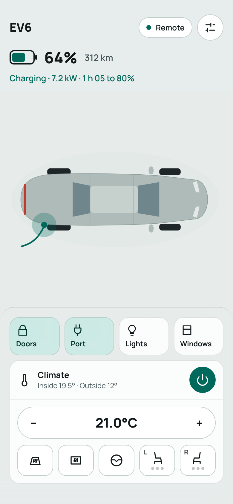

**Bluetooth-only sections.** Below the climate bar, over BLE only:

*   **Live data:** compact stat cards (pack voltage, power, pack temperatures, gear, power state for E-GMP). An "Edit layout" action lets the user reorder and hide.
*   **Advanced controls:** the same button component (for example battery preheat), plus an "Add" tile.

Over MQTT these sections are not shown. This matches the transport rule in [Architecture](architecture.md): advanced state, advanced commands and system commands are BLE-only.

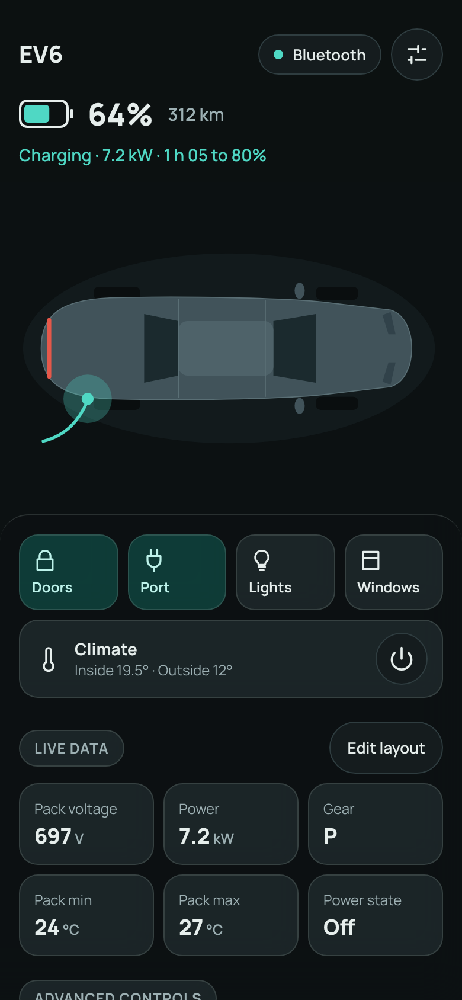

**Customisation.** Over BLE the user can add, remove and reorder stat cards and buttons, and the order is saved per vehicle. The mockups show the entry points ("Edit layout", "Add") but not the editing flow.

### Wide layout
On tablets and landscape the hero fills the left column (header over it), and the controls move to a fixed-width solid side column that scrolls on its own. The same components are used.

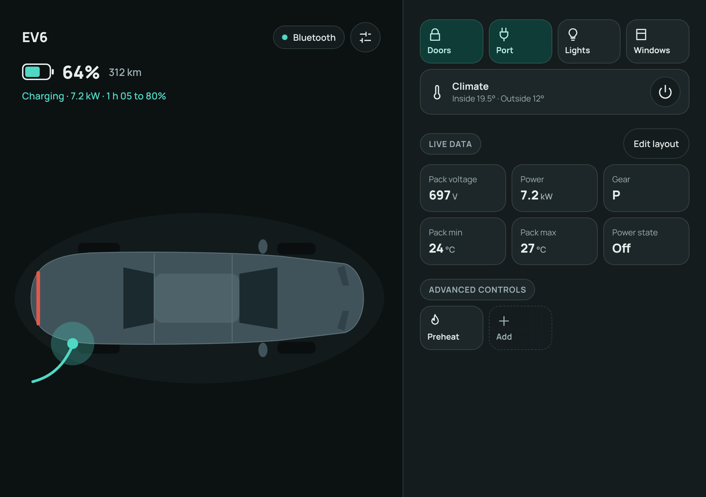

## Tiers
| | Remote (MQTT) | Bluetooth (BLE; also stub/HTTP in debug) |
|---|---|---|
| Header, hero, status | yes | yes |
| Button grid, climate bar | basic commands | basic commands |
| Live data, advanced controls, Edit layout | no | yes |
| System commands (settings screens) | no | yes |

Gate on the transport type, never on the vehicle (see the transport gating in [Architecture](architecture.md)). Over MQTT, do not show a disabled advanced section; leave it out.

## States and edge cases
*   **Not connected / stale.** The pill says Offline and when the state was last updated. Values from the last snapshot stay on screen but must not look live (dim them, or mark them). This overlaps with [Show stale or asleep vehicle state](https://github.com/OpenCarControls/mobile-app/issues/29).
*   **Command pending.** Only the button that sent the command pulses. Others stay usable unless the platform forbids concurrent commands.
*   **Unavailable commands.** A button for a command the current link or car state can't run is dimmed and says why on tap (for example "Needs Bluetooth"). This overlaps with [Gray out unavailable commands](https://github.com/OpenCarControls/mobile-app/issues/22).
*   **Platform mismatch.** The existing mismatch banner appears under the header and keeps its unpair action.
*   **Charging.** The charge-port button is on, the hero shows the cable and the port glow, and the status line shows the charging text.
*   **Driving.** The hero shows the car on an advancing road, the speed is shown at the top right, and the status line says Driving. Charging text is hidden.
*   **Units.** Distance, speed and temperature follow the car's units (km/miles, °C/°F). The climate target steps in the car's own steps (for example 1 °F). Keep the existing formatting helpers' behaviour.
*   **Pull to refresh.** The existing pull-to-refresh that retries the BLE connection must keep working. It needs a new gesture target now that the controls scroll over the hero (the controls layer when scrolled to the top is the natural one; not yet designed).
*   **Settings.** The settings button replaces the overflow menu: unpair (with its confirmation), open-source licences, and debug-only entries. The debug drawer (opened by a long press on the vehicle name in debug builds) and the HTTP simulation toggle stay behind `kDebugMode`.

## Vehicle description
Each platform declares what the shared screen shows. This is a proposal for the shape, not a final API:

*   **Identity:** display name, skin ([Theming](ui-theming.md)), hero builder ([3D hero](ui-hero.md)).
*   **Energy:** one or two levels, each battery or fuel, with accessors for the level and the range.
*   **Status:** a function from state to the status line, or nothing. Includes the speed to show while driving.
*   **Buttons:** an ordered list. Each has an id, icon (and alternate icon for its state), title, accessible label, tier (basic or advanced), a state accessor (on / off / unavailable) and a command.
*   **Climate:** whether present, target range and step (in °C and the car's own steps), the inside/outside temperature accessors, and the list of extras (id, icon, kind: toggle or leveled, side tag).
*   **Live stats:** an ordered list for BLE: label, value formatter, unit.
*   **Layout memory:** a stable id per button and stat, so the user's order can be saved and survive app updates that add items.

Rules from the repo that still apply: merge incoming state with `mergeFromMessage`, take `source_device_id` from `bleSourceDeviceIdProvider`, import UUIDs and IDs from generated constants, and keep debug-only paths behind `kDebugMode`.

## Not yet placed
The current dashboards show things the mockups do not have a place for yet. They must be placed or consciously dropped when the dashboard is rebuilt: odometer, per-door and per-window state, frunk and trunk state, indoor temperature outside the climate bar, preconditioning detail, and the advanced E-GMP values ([#35](https://github.com/OpenCarControls/mobile-app/issues/35)), tire pressures and the 12 V battery ([#34](https://github.com/OpenCarControls/mobile-app/issues/34)) and the preconditioning toggle ([#36](https://github.com/OpenCarControls/mobile-app/issues/36)). Door, frunk and trunk state is a natural fit for the hero (open doors drawn open).

## Accessibility
*   Touch targets are at least 44 dp.
*   Text contrast 4.5:1, large text and component boundaries 3:1. Skins must pass (see [Theming](ui-theming.md#contrast)).
*   Every icon-only control has a label; stateful buttons announce their state.
*   Colour is never the only state indicator. Fill is paired with an icon change or text.
*   Honour the system's reduce-motion setting: no pulsing, scrolling road or camera glide.
*   The scrolling controls must stay reachable with large system font sizes (the layer scrolls; the hero box shrinks to its minimum).

## Mockups and screenshots
The mockups are in [`ui/mockups`](ui/mockups/README.md); the screenshots below were rendered from them. They are a design reference, not pixel specs: icons and glyphs are demo drawings and the real UI uses standard icons.

| | |
|---|---|
| 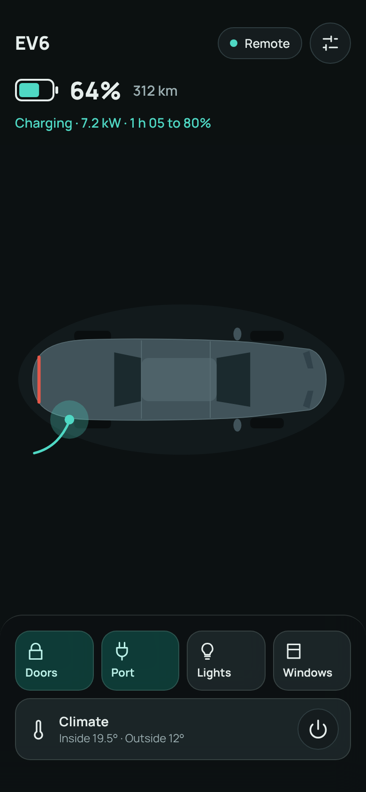 Remote, dark | 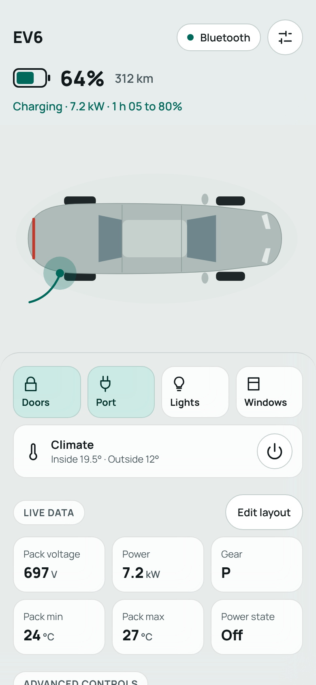 Bluetooth, light |
| 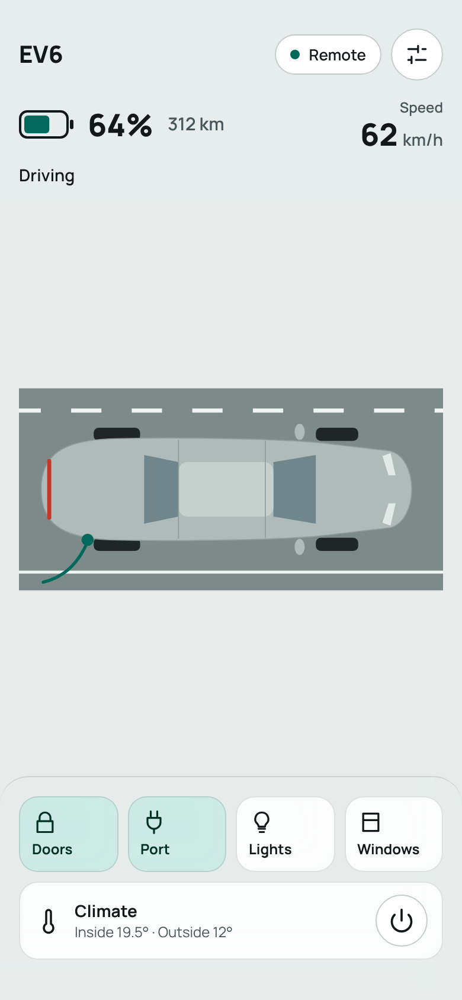 Driving (remote) | 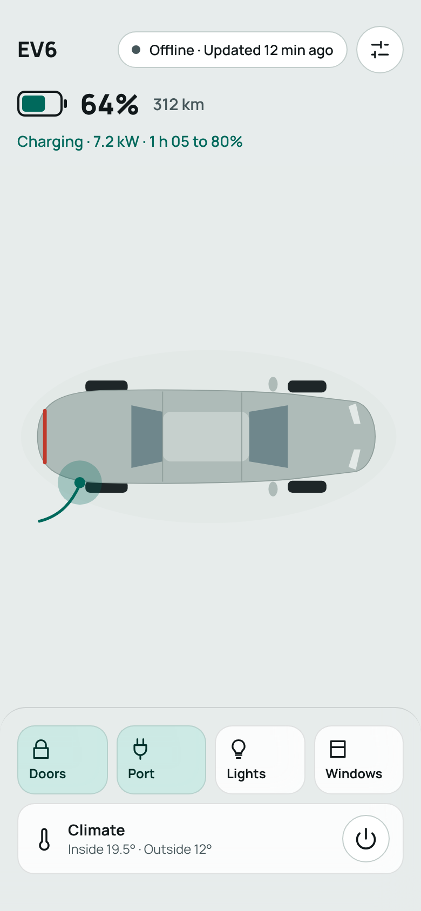 Offline pill |
| 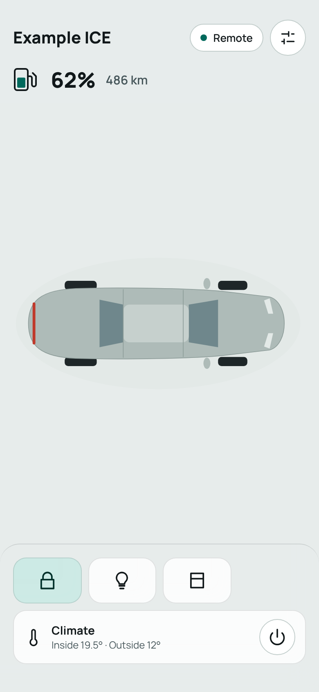 ICE, remote, icon-only buttons | 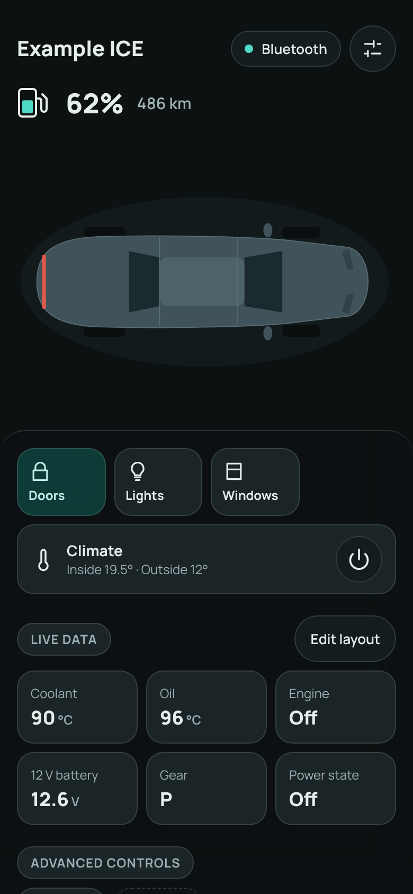 ICE, Bluetooth |
| 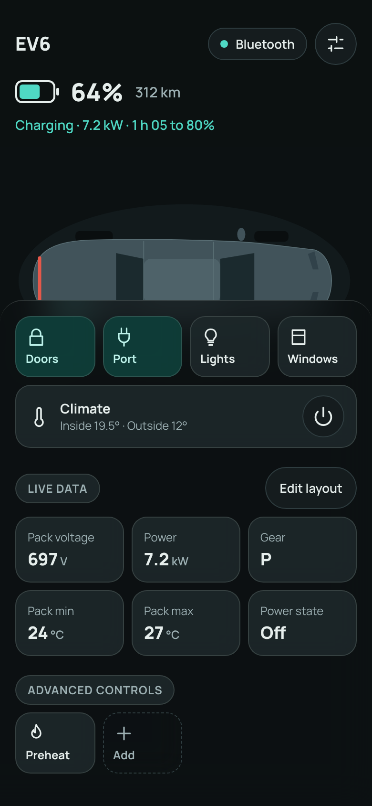 Controls scrolled to the end | 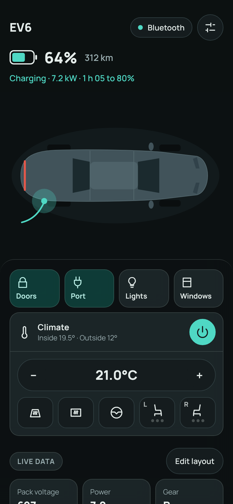 Climate on, hero moved up |

Design explorations that led to these choices:

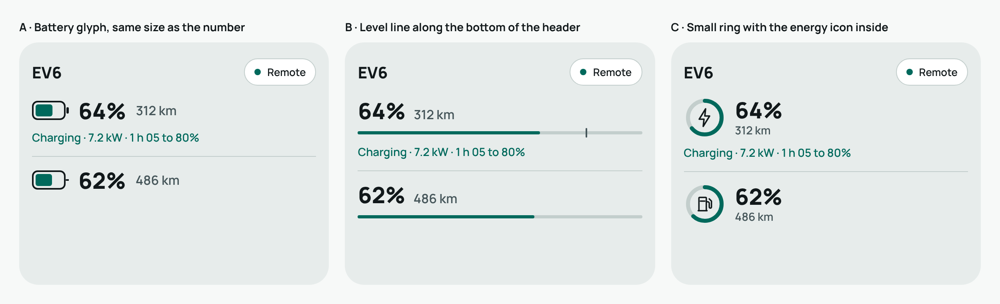
Level indicator options. A (battery glyph beside the number) was chosen.

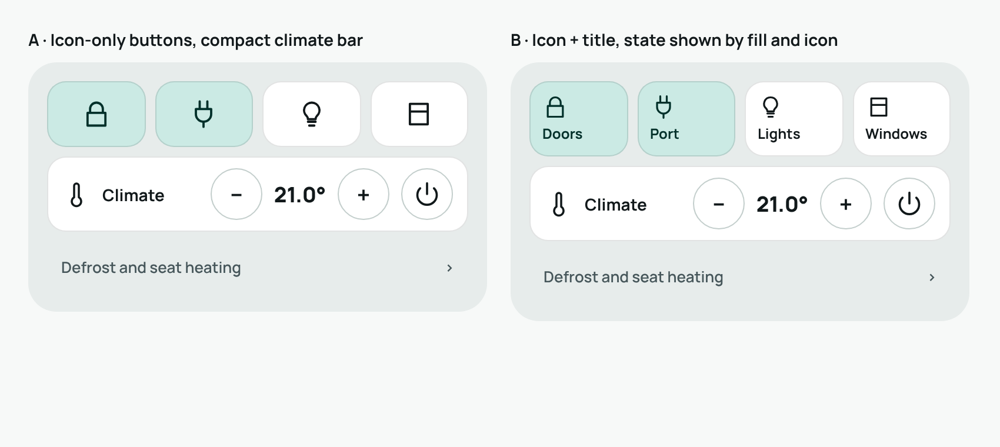
Control button options. Both were kept: A (icon-only) and B (icon + title) are a per-platform choice, B by default.

## Open questions
*   Where does pull-to-refresh live, and does the header ever need a refresh indicator?
*   Tap on the level to swap percent and range?
*   Do the climate extras work with climate off on each car? (Assumed no.)
*   The error and unavailable button states, and the "Edit layout" flow, are not designed.
*   Where do odometer, tire pressures and 12 V go?
*   Is the hero box minimum height right on small phones and with large fonts?
